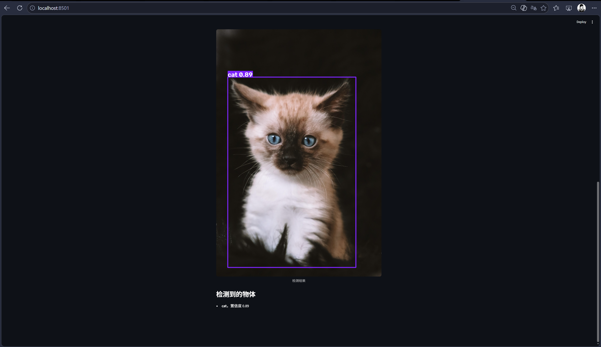

# AI 面试项目

## 项目结构

- `chat-web/`：通过 Dify API 调用本地 Ollama 模型的聊天网页
- `yolo-web/`：（待完成）YOLO 训练与检测网页
- `notes/`：工程日志

## 已完成

### chat-web
- Ollama 本地运行 Qwen 模型
- Dify 创建 Chatflow 应用并发布
- 原生 HTML/JS 网页，通过 Dify API 对话
- 运行方式：用 VS Code Live Server 打开 `chat-web/index.html`

## 运行说明

`chat-web/script.js` 里的 `API_KEY` 需要替换成自己的 Dify 密钥，`API_URL` 指向自己的 Dify 服务。

### yolo-web
- Python 3.12 虚拟环境 + ultralytics 8.4.185
- 用 coco8 跑通 yolo11n.pt 训练（10 epoch，CPU），生成 best.pt
- Streamlit 图片上传检测网页，加载 `../runs/detect/train/weights/best.pt`
- 运行方式：
  cd yolo-web
  .\.venv\Scripts\python.exe -m streamlit run app.py
  